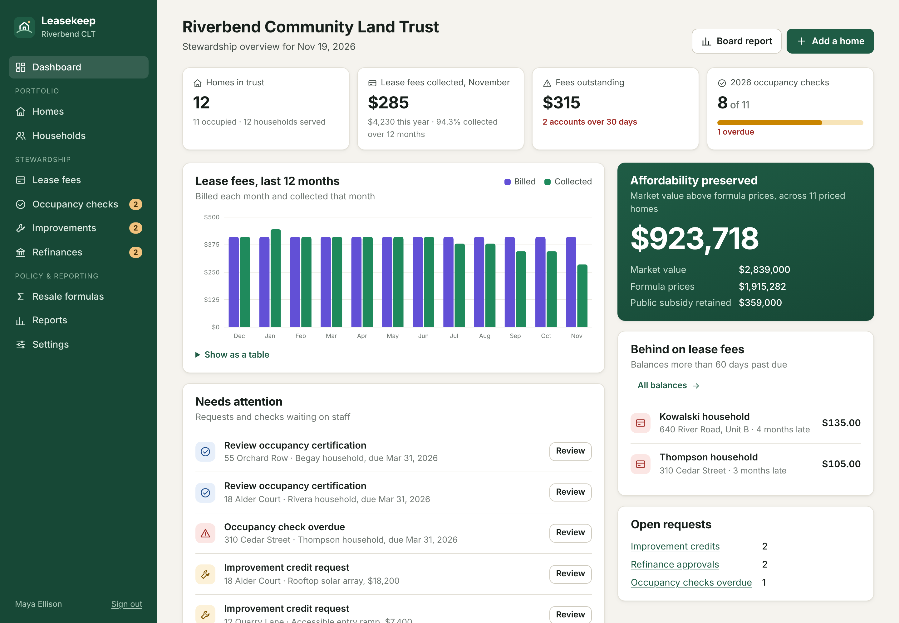
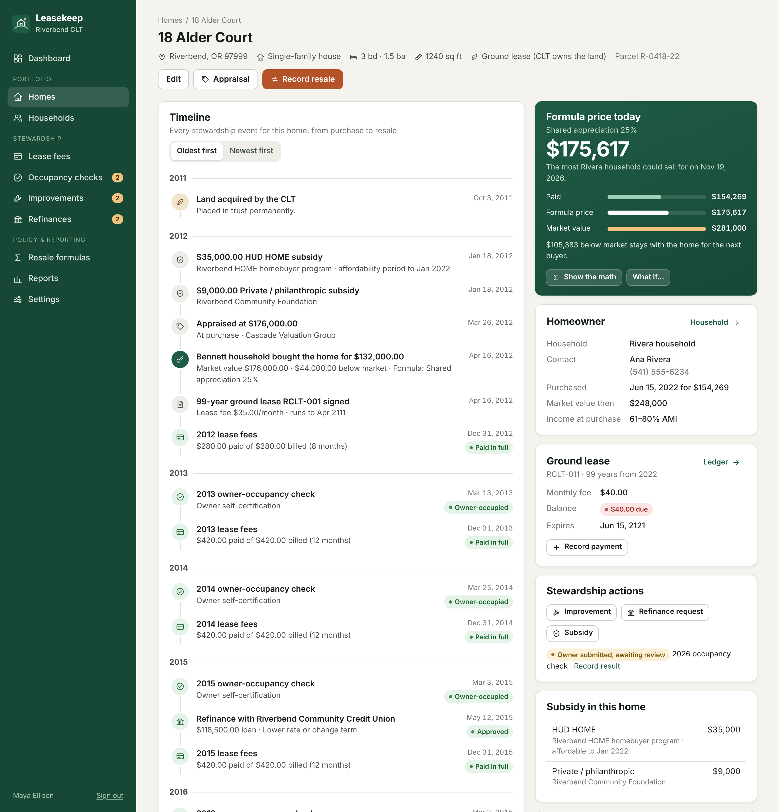
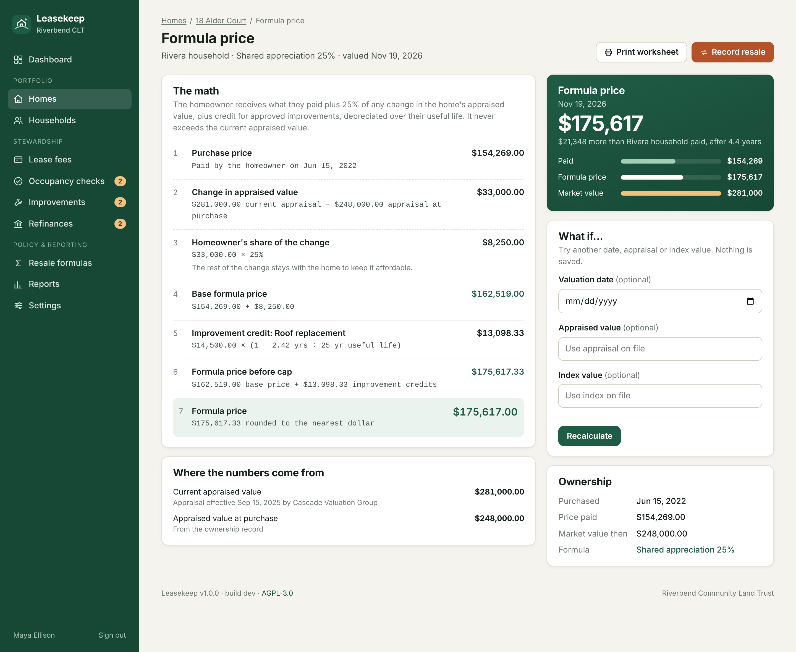
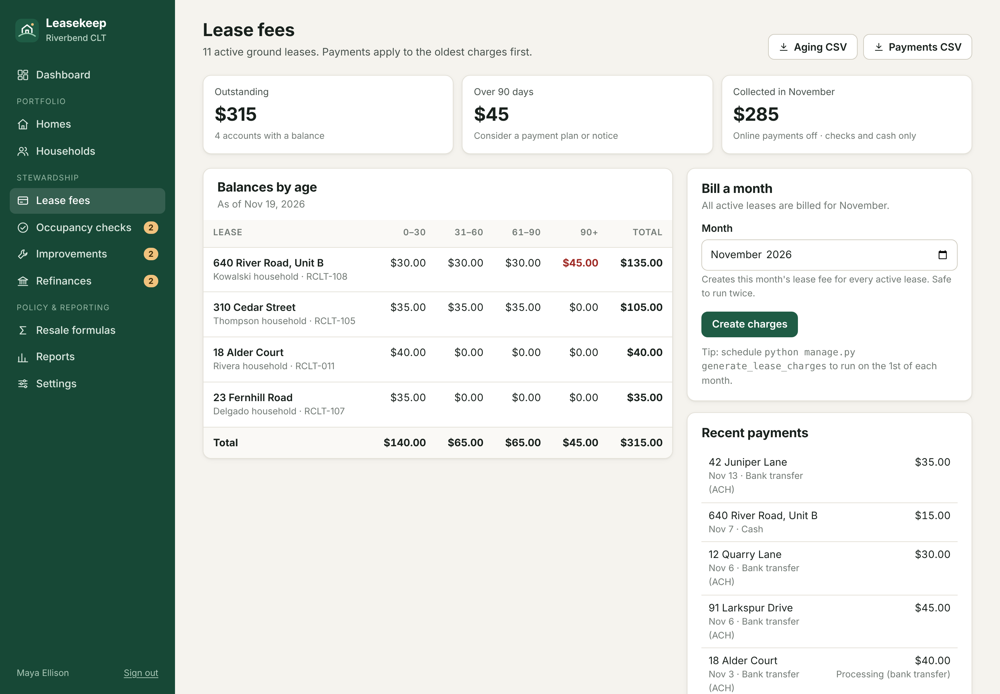
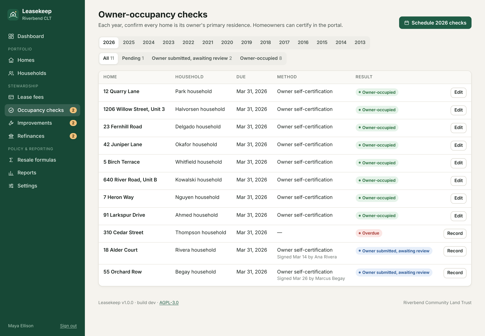
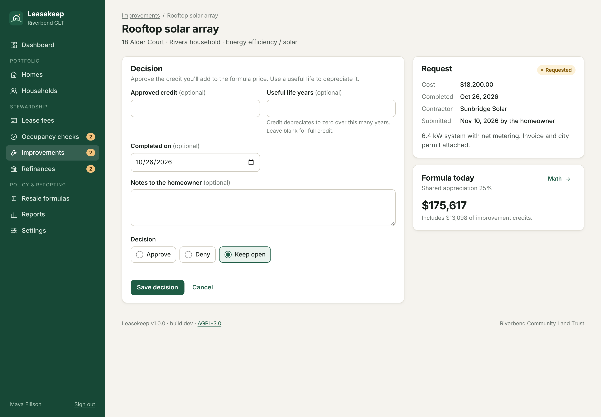
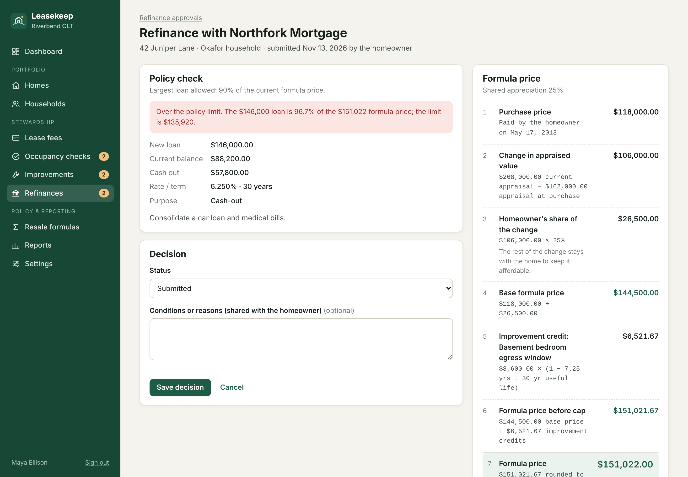
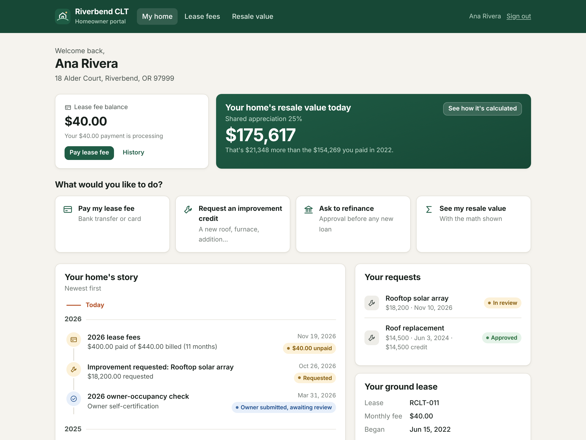
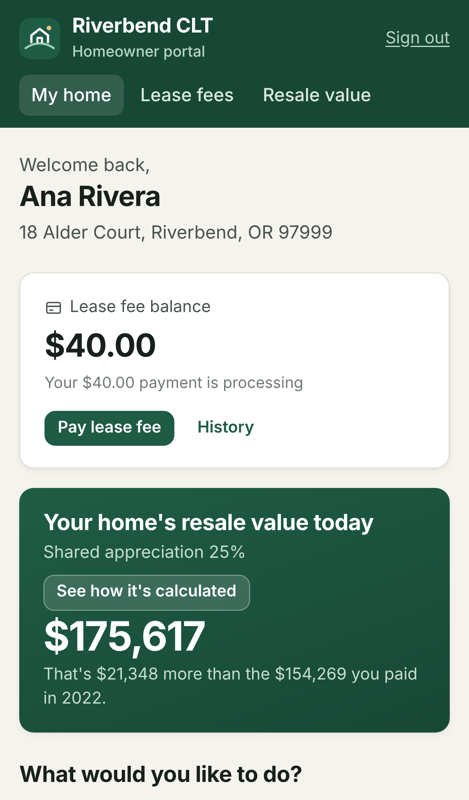
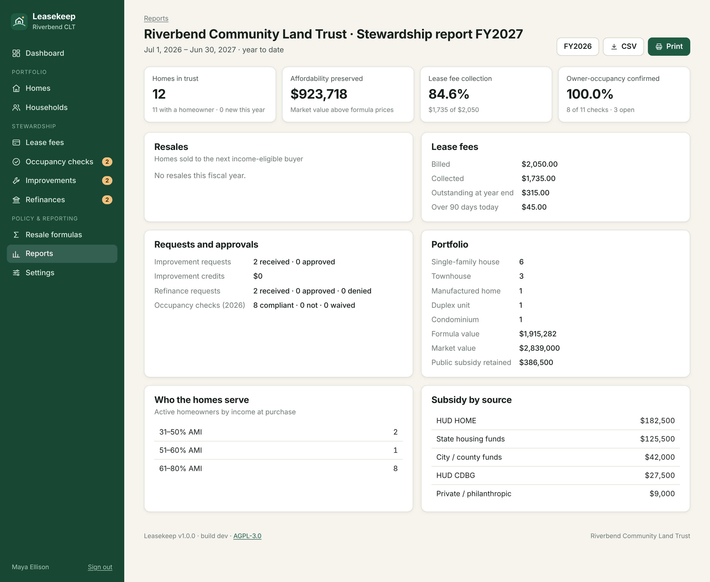

<div align="center">


# Leasekeep

**Stewardship software for community land trusts.**

Ground leases, lease fees, owner-occupancy checks, capital improvement credits, refinance approvals and resale formula prices for every home in the trust, kept for decades and shown with the math visible.

[](https://github.com/lobojoel2003/Leasekeep/actions/workflows/ci.yml)
[](https://github.com/lobojoel2003/Leasekeep/actions/workflows/release.yml)
[](https://github.com/lobojoel2003/Leasekeep/releases/latest)
[](LICENSE)




</div>

---

## Contents

- [Why Leasekeep](#why-leasekeep)
- [Features](#features)
- [Resale formulas](#resale-formulas)
- [Quick start](#quick-start)
- [Self-hosting with Docker](#self-hosting-with-docker)
- [Configuration](#configuration)
- [Online lease fee payments (Stripe)](#online-lease-fee-payments-stripe)
- [Scheduled jobs](#scheduled-jobs)
- [Reports and HUD/HOME compliance](#reports-and-hudhome-compliance)
- [Versions, builds and releases](#versions-builds-and-releases)
- [CI/CD](#cicd)
- [Development](#development)
- [Project layout](#project-layout)
- [Security and privacy](#security-and-privacy)
- [License](#license)

## Why Leasekeep

Community land trusts (CLTs) keep homes permanently affordable. The CLT owns the land and leases it to the homeowner, usually on a 99-year ground lease. When the owner sells, a **resale formula** caps the price so the next buyer can afford it. The owner gets back what they paid plus a fair share of appreciation; the rest of the gain stays with the home.

Grounded Solutions Network counts [upwards of 300 CLTs in the US](https://frameworkhomeownership.org/how-community-land-trusts-work/), and cities keep funding new ones ([National League of Cities guide](https://www.nlc.org/wp-content/uploads/2021/08/Community-Land-Trusts_A-Guide-for-Local-Governments_Report-1.pdf)). Each one must track ground lease fees, owner-occupancy checks, capital improvement credits, refinance approvals and the formula price of every home, often for decades, often with two or three staff and a filing cabinet. [Burlington Associates' stewardship manual](https://burlingtonassociates.com/wp-content/uploads/2024/08/Stewardship-Policies-Procedures-Template-Manual-FINAL-with-Appendices.pdf) lists those duties; Leasekeep is software for them.

The sector standard, HomeKeeper, is a paid Salesforce product that needs a Salesforce administrator, which small CLTs rarely have. Leasekeep is a single, self-hostable Django app with PostgreSQL, licensed AGPL-3.0.

## Features

### A timeline for every home, from purchase to resale

Land acquisition, subsidies, appraisals, each sale, the ground lease, a yearly roll-up of lease fees, improvement credits, refinances and annual occupancy checks, in order. Resales show both households' stories on one page.



### Formula prices with the math visible

Every price comes with a numbered worksheet. Each money line is rounded to the cent before it feeds the next, so anyone can reproduce it with a calculator. A *What if…* panel re-prices with another date, appraisal or index value without saving anything. The page prints cleanly for a closing file.



### Stewardship workflows

| | |
|---|---|
| **Lease fees.** Monthly charges (idempotent), payments applied oldest-first, waivers, late fees, a ledger per lease and 0–30/31–60/61–90/90+ aging. | **Owner-occupancy checks.** Schedule a year's checks in one click; owners self-certify in the portal; staff record site visits and document reviews. |
|  |  |
| **Capital improvement credits.** Owners request credits with receipts. Staff approve a credit amount and an optional useful life for straight-line depreciation. | **Refinance approvals.** Every request is checked against your loan-to-formula-price policy (90% by default) before you decide. |
|  |  |

### A homeowner portal

Homeowners sign in to pay lease fees by ACH bank transfer or card, see their resale value with the same worksheet staff see, request improvement credits, ask to refinance and submit their yearly occupancy certification. It works on a phone.

<p>


</p>

### Board reports and compliance exports

A printable annual stewardship report for any fiscal year: portfolio, resales and the equity sellers gained, lease fee collection, occupancy compliance, approvals, subsidy retained, who the homes serve and **affordability preserved** (market value minus formula prices). Every report also downloads as CSV.



The **HUD HOME compliance export** lists each HOME-assisted home with its affordability period under [24 CFR 92.254](https://www.ecfr.gov/current/title-24/subtitle-A/part-92/subpart-F/section-92.254), IDIS activity IDs, beneficiary data in IDIS categories, and principal-residence verification. See [Reports and HUD/HOME compliance](#reports-and-hudhome-compliance).

### Also included

- **Django admin** for settings and rare edits, with every model registered.
- **Email notifications** to staff when owners submit requests, and to owners when decisions are made.
- **Portal invitations**: staff invite a household by email; the owner sets their own password.
- **Health endpoint** at `/healthz` reporting version, build number, commit and database status.
- **Accessible, dependency-free UI**: server-rendered pages, no JavaScript framework or CDN, a validated colour-blind-safe chart palette, keyboard-reachable chart tooltips and a table view for every chart.

## Resale formulas

Formulas are configured in the app, not in code. Each ownership keeps the formula written into its ground lease.

| Type | Base price | Options |
|---|---|---|
| **Appraisal-based** (shared appreciation) | purchase price + *share* × (current appraisal − appraisal at purchase) | share %; optionally scale the share by purchase price ÷ initial appraisal (Champlain Housing Trust single-family and CPAH do this) |
| **Indexed** | purchase price × (index now ÷ index at purchase) | any index series you maintain, e.g. HUD Area Median Income or CPI |
| **Fixed rate** | purchase price × (1 + rate)<sup>years</sup>, or × (1 + rate × years) | annual rate; compound or simple; partial years by complete months or whole years only |

Every formula can also:

- add **capital improvement credits**, at full value or depreciated straight-line over each improvement's useful life;
- **cap** the price at the current appraised value (the lesser of formula and market, as in the 2011 CLT Network model ground lease §10.9);
- **floor** the base price at the original purchase price;
- round to the cent, dollar or $100.

### Tested against published examples

The formula engine ([`leasekeep/formulas/engine.py`](leasekeep/formulas/engine.py)) is plain Python with no Django dependency. Its unit tests reproduce worked examples published by CLTs, HUD and evaluators, each cited in [`tests/test_engine.py`](tests/test_engine.py):

| Source | Formula | Published result |
|---|---|---|
| HUD *HOMEfires* Vol. 15 No. 1 (2020) | 25% of appraised appreciation | $168,750 |
| Champlain Housing Trust (Urban Institute case study, 2010) | 25% × (price ÷ appraisal) × appreciation | $112,500 |
| Champlain Housing Trust testimony to the Vermont House (2021, 2025) | 25% of appreciation | $170,000 · $180,000 |
| Community Partners for Affordable Housing (IL) | 15%, scaled, plus a roof depreciated over 15 years | $188,100 |
| City of Flagstaff CLT program | 25% of appreciation | $208,300 |
| One Roof Community Housing (Duluth, MN) | 25% of appreciation | $205,000 |
| Housing Land Trust of the North Bay | HUD AMI index | $338,861.99 |
| San Francisco MOHCD BMR repricing | AMI index | $321,810 |
| Big River CLT | 1.5% compounded, 7 years | $388,446 |
| Homestead CLT (Seattle) | 1.5% compounded, 7 years | $221,968 (truncated; exact $221,968.98) |
| Houston CLT | 1.25% simple, 5 years | $79,810 |
| UT Austin CLT toolkit | 2% simple | $102,000 · $104,000 |

Where a publication rounds an intermediate figure differently, the test asserts Leasekeep's exact result and explains the difference. [`docs/resale-formulas.md`](docs/resale-formulas.md) has the details and links.

## Quick start

Requires Python 3.12+.

```bash
git clone https://github.com/lobojoel2003/Leasekeep.git
```

```bash
cd Leasekeep && python -m venv .venv && . .venv/bin/activate
```

```bash
pip install -r requirements-dev.txt
```

```bash
python manage.py migrate && python manage.py seed_demo --with-users
```

```bash
python manage.py runserver
```

Open <http://127.0.0.1:8000> and sign in:

| Role | Sign in | Password |
|---|---|---|
| Staff (Riverbend CLT) | `staff` | `leasekeep-demo` |
| Homeowner (Ana Rivera) | `ana.rivera@riverbendclt.example` | `leasekeep-demo` |

`seed_demo` loads *Riverbend Community Land Trust*, an invented CLT with twelve homes, three resale formulas, an AMI index, fifteen years of lease fees, a completed resale and open requests. Every name, address and number in it is fictional. Without `DATABASE_URL`, development uses SQLite; set `DATABASE_URL=postgres://…` to use PostgreSQL.

To start your own CLT instead, skip `seed_demo`, then:

```bash
python manage.py createsuperuser
```

Sign in, open **Settings** to name your organization and set policy (lease fee due day, grace period, refinance limit, fiscal year), create your resale formulas, then add homes and households.

## Self-hosting with Docker

Each release publishes a multi-architecture image (`linux/amd64`, `linux/arm64`) to the GitHub Container Registry: `ghcr.io/lobojoel2003/leasekeep`. You need two files: `docker-compose.yml` and a `.env` settings file. Download `docker-compose.yml` and `env.example` from the [latest release](https://github.com/lobojoel2003/Leasekeep/releases/latest) and save `env.example` as `.env`. Or, from a clone of this repository:

```bash
cp .env.example .env
```

Edit `.env`: set `DJANGO_SECRET_KEY`, `DJANGO_ALLOWED_HOSTS`, `POSTGRES_PASSWORD` and email settings. Then start Leasekeep and PostgreSQL:

```bash
docker compose up -d
```

Create the first staff account:

```bash
docker compose exec web leasekeep-entrypoint manage.py createsuperuser
```

The container runs migrations on start, serves on port 8000 with gunicorn, keeps uploads in the `/data` volume, runs as an unprivileged user and has a built-in health check. Put it behind a TLS-terminating proxy (Caddy, nginx, Traefik or your host's load balancer). For a quick local trial without HTTPS, set `DJANGO_SECURE_SSL_REDIRECT=false`.

Pin a version with `LEASEKEEP_TAG=1.0.0` in `.env`. Back up the `pgdata` and `media` volumes.

## Configuration

All settings come from environment variables; [`.env.example`](.env.example) lists them with comments.

| Variable | Default | Purpose |
|---|---|---|
| `LEASEKEEP_ENV` | `development` (source) · `production` (image) | Selects defaults. Production requires a secret key and enables HTTPS-only cookies, HSTS and SSL redirect. |
| `DJANGO_SECRET_KEY` | none | Required in production. |
| `DJANGO_ALLOWED_HOSTS` | `localhost…` in development | Comma-separated host names. |
| `DJANGO_CSRF_TRUSTED_ORIGINS` | none | e.g. `https://leasekeep.example.org` |
| `DATABASE_URL` | SQLite file | Any [dj-database-url](https://github.com/jazzband/dj-database-url) URL; PostgreSQL recommended. |
| `LEASEKEEP_TIME_ZONE` | `America/New_York` | Local time zone for due dates and reports. |
| `EMAIL_HOST`, `EMAIL_PORT`, `EMAIL_HOST_USER`, `EMAIL_HOST_PASSWORD`, `EMAIL_USE_TLS`, `DEFAULT_FROM_EMAIL` | console backend in development | Outgoing email for invitations, password resets and notifications. |
| `LEASEKEEP_STAFF_NOTIFICATION_EMAIL` | none | Inbox that hears about new owner requests. |
| `STRIPE_SECRET_KEY`, `STRIPE_WEBHOOK_SECRET` | none | Enable online lease fee payments. |
| `STRIPE_PAYMENT_METHOD_TYPES` | `us_bank_account,card` | Remove `card` for ACH only. |
| `LEASEKEEP_MAX_UPLOAD_MB` | `10` | Largest receipt or lease upload. |
| `DJANGO_SECURE_SSL_REDIRECT`, `DJANGO_SECURE_HSTS_SECONDS`, `DJANGO_SECURE_HSTS_INCLUDE_SUBDOMAINS`, `DJANGO_SECURE_HSTS_PRELOAD` | `true`, one year, `true`, `false` | HTTPS policy in production. |
| `WEB_CONCURRENCY`, `GUNICORN_TIMEOUT`, `LEASEKEEP_MIGRATE_ON_START` | `3`, `60`, `1` | Container runtime. |

Policy that staff change without a deploy (lease fee due day, grace period, refinance limit, occupancy due month, fiscal year, portal welcome message) lives under **Settings → Organization settings**.

## Online lease fee payments (Stripe)

Leasekeep uses [Stripe Checkout](https://stripe.com/payments/checkout) for ACH bank transfers (`us_bank_account`) and cards. Without Stripe keys, the portal shows mailing instructions and staff record checks, cash and money orders.

1. Set `STRIPE_SECRET_KEY`.
2. In the Stripe dashboard add a webhook endpoint `https://<your-host>/stripe/webhook/` for these events: `checkout.session.completed`, `checkout.session.async_payment_succeeded`, `checkout.session.async_payment_failed`, `checkout.session.expired`.
3. Set `STRIPE_WEBHOOK_SECRET` to the endpoint's signing secret.

Bank transfers show as *processing* until they settle (usually 3–5 business days), then become *received*. Webhooks are signature-verified and idempotent.

## Scheduled jobs

Run these from cron, a systemd timer or your platform's scheduler. Both are safe to run repeatedly.

| When | Command |
|---|---|
| 1st of every month | `python manage.py generate_lease_charges` |
| Once a year, before occupancy checks are due | `python manage.py schedule_occupancy_checks` |

Inside Docker, prefix with `docker compose exec web leasekeep-entrypoint manage.py …`. To backfill charges when you start using Leasekeep mid-year: `generate_lease_charges --from 2026-01 --month 2026-11`.

## Reports and HUD/HOME compliance

**Reports** offers:

- **Annual board report**, HTML for printing or CSV, for any fiscal year. Fiscal years are named by the year they end, so with a July start FY2027 runs Jul 2026–Jun 2027.
- **HUD HOME compliance**: preview or CSV.
- **Portfolio valuation**: every home's formula price, appraisal and affordability gap, as CSV.
- **Lease fee aging** and **payments received** for a date range, as CSV.

HOME affordability periods follow 24 CFR 92.254(a)(4). The [2025 HOME final rule](https://www.federalregister.gov/documents/2025/01/06/2024-29824/home-investment-partnerships-program-program-updates-and-streamlining) raised the per-unit thresholds for funds committed on or after its effective date, April 20, 2025: under $25,000 is 5 years, $25,000–$50,000 is 10 years and over $50,000 is 15 years. Earlier commitments keep the prior $15,000 and $40,000 thresholds. Leasekeep chooses the rule from each subsidy's commitment date. Where your written agreement requires a longer period, enter it as an override on the subsidy. Column names follow HUD IDIS vocabulary so the file pastes into a participating jurisdiction's workbook, but it is not an official HUD format. Check it against your PJ's requirements.

## Versions, builds and releases

- **Semantic versioning.** The version lives in one place, [`leasekeep/__init__.py`](leasekeep/__init__.py), and is read by packaging, the UI footer, `/healthz` and CI.
- **Build numbers.** Each CI and release run stamps its GitHub Actions run number and commit into the wheel (`leasekeep/build_info.json`) and the image (`LEASEKEEP_BUILD_NUMBER`, `LEASEKEEP_GIT_SHA`). The footer shows them as, for example, `Leasekeep v1.0.0 · build 12 · 3f2c1ab`.
- **Tags.** Releases are tagged `vMAJOR.MINOR.PATCH`. Images are tagged `1.0.0`, `1.0`, `1`, `latest`, `build-<n>` and `sha-<commit>`.
- **Changelog.** [`CHANGELOG.md`](CHANGELOG.md) follows [Keep a Changelog](https://keepachangelog.com/en/1.1.0/); each release's notes come from its section.

To cut a release:

1. Bump `__version__` in `leasekeep/__init__.py` and add a `## [x.y.z] - YYYY-MM-DD` section to `CHANGELOG.md`.
2. Merge to `main`, then tag and push:

```bash
git tag -a v1.1.0 -m "Leasekeep v1.1.0" && git push origin v1.1.0
```

The release workflow refuses tags that don't match the version or have no changelog section. You can also run **Actions → Release → Run workflow** with a tag name to create the release from a commit.

## CI/CD

| Workflow | Runs on | What it does |
|---|---|---|
| [`ci.yml`](.github/workflows/ci.yml) | every push and pull request | Ruff lint and format check; tests on Python 3.12 and 3.13 against PostgreSQL 16 with coverage; migration drift check; `check --deploy` on production settings; builds the wheel, sdist and Docker image with the build number; boots the container and smoke-tests `/healthz`, the sign-in page and demo data. |
| [`release.yml`](.github/workflows/release.yml) | `v*.*.*` tags, or by hand | Verifies tag, version and changelog; runs the tests; builds the wheel, sdist and `SHA256SUMS`; pushes the multi-arch image to GHCR; publishes the GitHub Release with notes from the changelog; optionally calls a deploy hook. |
| [`dependabot.yml`](.github/dependabot.yml) | weekly | Updates Python dependencies (staying on Django 5.2 LTS), GitHub Actions and the base image. |

**Continuous deployment.** Add a repository secret `DEPLOY_WEBHOOK_URL` (a Render, Railway, Coolify or Portainer deploy hook, for example) and every stable release triggers a deploy through the protected `production` environment.

## Development

```bash
pytest
```

```bash
ruff check . && ruff format --check .
```

The suite has 170+ tests and covers about 98% of the code: the formula engine, models, billing, Stripe webhooks, every staff and portal screen against the full demo portfolio, reports, exports and access control. Tests run on SQLite locally and on PostgreSQL in CI.

`make help` lists shortcuts, including `make screenshots`, which regenerates the README images with Playwright from a running demo server. See [CONTRIBUTING.md](CONTRIBUTING.md).

## Project layout

```
leasekeep/
├── formulas/      engine.py (pure-Python formula engine), formulas and index series
├── homes/         homes, households, ownerships, ground leases, appraisals,
│                  improvements, occupancy checks, refinances, subsidies, timeline
├── billing/       lease charges, payments, ledgers, aging, Stripe Checkout and webhooks
├── portal/        the homeowner portal
├── reports/       board report, HUD/HOME and CSV exports, portfolio metrics
├── core/          organization settings, dashboard, auth, charts, demo data
├── templates/     server-rendered HTML
└── static/        CSS, icons, a little progressive-enhancement JavaScript
tests/             pytest suite (engine tests cite published examples)
docker/            container entrypoint
scripts/           release helpers and the screenshot generator
```

## Security and privacy

Leasekeep stores personal and financial information about homeowners. Run it over HTTPS, keep the database and media volumes backed up and access-controlled, and give staff accounts only to staff. Homeowners can only see their own household's records, and tests enforce that. Card and bank details never touch Leasekeep; Stripe handles them. Please report vulnerabilities privately as described in [SECURITY.md](SECURITY.md).

## License

Leasekeep is free software under the [GNU Affero General Public License v3.0 or later](LICENSE). If you run a modified version for others over a network, you must offer them the source of your version.
